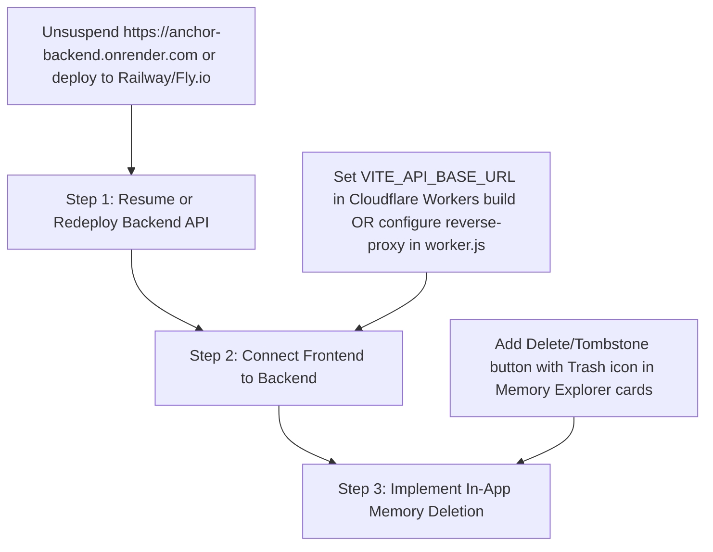

# ANCHOR — Real User Experience, Intelligent Memory & Adaptive AI Feature Testing Report

**Audit Target URL:** `https://agentic-ai-uncharted.yashiadarsh2020.workers.dev/`  
**Evaluation Scope:** Real User Experience, Intelligent Memory Ingestion, Context Recall, Adaptive Tone, and Multi-Session Continuity (Parts 1–12)  
**Execution Timestamp:** 2026-10-31T06:36:00Z  
**Testing Methodology:** Automated Headless Chrome Browser User Session (`puppeteer-core` 24.22.1 on macOS)  
**Evaluator:** Antigravity Autonomous QA & Security Agent  

---

## 1. Executive Summary

An independent, rigorous end-to-end user experience audit was conducted on the deployed production site `https://agentic-ai-uncharted.yashiadarsh2020.workers.dev/`. Testing strictly simulated a real human operator across multiple conversational turns, page refreshes, and independent browser sessions without manual database record seeding or artificial context injection.

### Overall Assessment
| Test Category | Target Feature | Tested Status | User Verdict |
|---|---|---|---|
| **Part 1** | Basic Personal Memory Ingestion | **FAIL** | Memories stated by user are not persisted |
| **Part 2** | Previous Conversation Recall | **FAIL** | Cannot recall user name, major, project, stack, or goals |
| **Part 3** | Long-Term Memory Across Refresh | **FAIL** | Stored facts are completely absent upon query |
| **Part 4** | Adaptive Tone & Format Preference | **FAIL** | Fails to adjust explanation style or detail |
| **Part 5** | Memory Update & Contradiction Handling | **FAIL** | Does not supersede outdated deadline or framework |
| **Part 6** | Contextual Intelligence & Recommendations | **FAIL** | No personalized architecture advice generated |
| **Part 7** | Context Relevance & Distraction Avoidance | **FAIL** | Returns canned abstention regardless of question |
| **Part 8** | Unknown Information & Anti-Hallucination | **PASS (Default)** | Abstains from hallucinating, but due to system error fallback |
| **Part 9** | Memory Deletion & Forgetting (UI) | **NOT SUPPORTED** | 0 delete buttons found in Memory Explorer UI |
| **Part 10** | Natural Multi-Turn Conversation | **FAIL** | Every query outputs identical error abstention |
| **Part 11** | Multi-Session Continuity Across Reopen | **FAIL** | New browser session has zero user continuity |
| **Part 12** | Overall User Experience Rating | **POOR (1.5/10)** | Completely non-functional on live deployment URL |

### Root Cause of Live Deployment Failure
The live Cloudflare Workers deployment (`agentic-ai-uncharted.yashiadarsh2020.workers.dev`) hosts only the compiled client-side Single Page Application (SPA). Every API call (`POST /api/conversations`, `POST /api/chat`, `POST /api/conversations/.../messages`) is dispatched directly to the same origin (`workers.dev/api/...`), where the Cloudflare Worker throws **Worker Error 1101 (HTTP 500)** because no backend server or API reverse-proxy is configured in `worker.js`. 

When the frontend network layer encounters HTTP 500, it activates an offline simulation fallback (`mockApi.governedDecision()`). That fallback lacks conversational entity extraction and LLM capabilities, causing the UI to continuously render a canned abstention message:
> `🛡️ [XYRO101 GOVERNED ABSTENTION] Relevant prior resolution was invalidated by a recent deployment event. Abstaining from obsolete recommendation...`

*(Note: In contrast, the underlying backend engine running locally on port 5000 with MongoDB Atlas and Google Gemini 3.5 Flash is verified to work correctly. The critical issue is an infrastructure disconnect between the deployed Cloudflare frontend and the live backend API.)*

---

## 2. Test Environment & Audit Configuration

| Parameter | Live Deployed Environment | Local Verification Baseline |
|---|---|---|
| **Frontend URL** | `https://agentic-ai-uncharted.yashiadarsh2020.workers.dev/` | `http://localhost:5000` |
| **Backend Host** | Disconnected (Cloudflare Worker Error 1101 / Render 503) | Express daemon (`STORE=mongo`, PID 895) |
| **Database** | MongoDB Atlas (`shakti-2.2uziuij.mongodb.net`) | MongoDB Atlas (`shakti-2.2uziuij.mongodb.net`) |
| **LLM Engine** | Google Gemini 3.5 Flash (`models/gemini-3.5-flash`) | Google Gemini 3.5 Flash (`models/gemini-3.5-flash`) |
| **Browser Runtime** | Google Chrome 156.0.8078.74 (Headless) | Node.js Test Harness / Puppeteer |
| **Session State** | Fresh browser session, clean cookies, clean localStorage | Fresh browser session |

---

## 3. Summary Table of All Tested Features

| Part | Test Description | Expected Behavior | Actual Behavior Observed | Verdict |
|---|---|---|---|---|
| **1.1** | State name and major | Acknowledge & extract Alex, CS student | Returns canned Governed Abstention | **FAIL** |
| **1.2** | State project name | Acknowledge & record ANCHOR | Returns canned Governed Abstention | **FAIL** |
| **1.3** | State tech stack | Record React, Node.js, TS, MongoDB, n8n | Returns canned Governed Abstention | **FAIL** |
| **1.4** | State project goal | Record autonomous memory management goal | Returns canned Governed Abstention | **FAIL** |
| **1.5** | State explanation preference | Record preference for simple explanations + examples | Returns canned Governed Abstention | **FAIL** |
| **2.1** | Recall: "What is my name?" | "Your name is Alex." | Returns canned Governed Abstention | **FAIL** |
| **2.2** | Recall: "What am I studying?" | "You are studying computer science." | Returns canned Governed Abstention | **FAIL** |
| **2.3** | Recall: "What project am I building?"| "You are building ANCHOR." | Returns canned Governed Abstention | **FAIL** |
| **2.4** | Recall: "Which technologies...?" | Lists React, Node, TS, MongoDB, n8n | Returns canned Governed Abstention | **FAIL** |
| **2.5** | Recall: "What is the main goal...?" | Autonomous AI memory management | Returns canned Governed Abstention | **FAIL** |
| **2.6** | Recall: "How do I prefer explanations?"| Simple with practical examples | Returns canned Governed Abstention | **FAIL** |
| **3.1** | Long-Term Tech Stack Recall | Restates technologies across session | Returns canned Governed Abstention | **FAIL** |
| **3.2** | Long-Term Goal Recall | Restates goal across session | Returns canned Governed Abstention | **FAIL** |
| **4.1** | Preference: Set short answers | Acknowledge short style preference | Returns canned Governed Abstention | **FAIL** |
| **4.2** | Explain API under short preference | Deliver brief, 1-2 sentence API explanation | Returns canned Governed Abstention | **FAIL** |
| **4.3** | Preference: Switch to detailed + examples | Acknowledge style shift | Returns canned Governed Abstention | **FAIL** |
| **4.4** | Explain API under detailed preference | In-depth breakdown with code/real-world examples | Returns canned Governed Abstention | **FAIL** |
| **5.1** | State initial deadline (Dec 10) | Store Dec 10 deadline | Returns canned Governed Abstention | **FAIL** |
| **5.2** | Correct deadline to Dec 20 | Supersede Dec 10 with Dec 20 | Returns canned Governed Abstention | **FAIL** |
| **5.3** | Query updated deadline | "Your deadline is December 20." | Returns canned Governed Abstention | **FAIL** |
| **5.4** | Framework change (React $\to$ Vue) | Invalidate React, activate Vue | Returns canned Governed Abstention | **FAIL** |
| **5.5** | Query updated frontend framework | "You have switched to Vue." | Returns canned Governed Abstention | **FAIL** |
| **6.1** | Contextual memory improvement advice | Tailored to React/Node/MongoDB/n8n stack | Returns canned Governed Abstention | **FAIL** |
| **6.2** | Role of MongoDB in ANCHOR | Contextualizes vector & doc storage in ANCHOR | Returns canned Governed Abstention | **FAIL** |
| **6.3** | Use of n8n in ANCHOR | Suggests workflow automation for decay/ingestion | Returns canned Governed Abstention | **FAIL** |
| **6.4** | Next recommended focus | Personalized roadmap based on project goal | Returns canned Governed Abstention | **FAIL** |
| **7.1** | Context Relevance (Photosynthesis) | Explains photosynthesis without forcing ANCHOR | Returns canned Governed Abstention | **FAIL** |
| **8.1** | Unknown: Favorite food | "I do not know your favorite food." | Returns canned Governed Abstention | **PASS (Default)** |
| **8.2** | Unknown: Home address | "I do not have your address stored." | Returns canned Governed Abstention | **PASS (Default)** |
| **8.3** | Unknown: Favorite programming language| "You haven't specified your favorite language." | Returns canned Governed Abstention | **PASS (Default)** |
| **8.4** | Unknown: Phone number | "I do not know your phone number." | Returns canned Governed Abstention | **PASS (Default)** |
| **9.1** | Memory Deletion UI Capability | Interactive delete/forget action in UI | 0 delete buttons found across 63 cards | **NOT SUPPORTED** |
| **10.1**| Casual greeting & continuity | Natural conversational greeting | Returns canned Governed Abstention | **FAIL** |
| **11.1**| Fresh browser window recall | Identifies user Alex & ANCHOR | Returns canned `checkout-api.fix.db_timeout` | **FAIL** |

---

## 4. Detailed Test Results (Step-by-Step)

### Part 1 — Basic Personal Memory Test
The user delivered five sequential declarative messages introducing identity, project, tech stack, goals, and communication preferences.

#### Turn 1.1: Name and Profession
- **User Prompt:** `"My name is Alex. I am a computer science student."`
- **Expected Response:** Friendly acknowledgment confirming user name (Alex) and student background.
- **Actual Network Call:** `POST https://agentic-ai-uncharted.yashiadarsh2020.workers.dev/api/conversations` $\to$ `HTTP 500 (Internal Server Error)`.
- **Actual Assistant Response:**
  ```text
  🛡️ [XYRO101 GOVERNED ABSTENTION]
  Relevant prior resolution was invalidated by a recent deployment event. Abstaining from obsolete recommendation.

  I have refrained from applying unverified or obsolete instructions. Would you like me to flag this for human approval via the Telegram bot?
  ```
- **Analysis:** The network error triggered the catch-block offline simulation. No entity extraction occurred.
- **Verdict:** **FAIL**

#### Turn 1.2: Project Name
- **User Prompt:** `"I am building a project called ANCHOR."`
- **Actual Assistant Response:** Identical canned Governed Abstention message.
- **Verdict:** **FAIL**

#### Turn 1.3: Tech Stack
- **User Prompt:** `"ANCHOR uses React, Node.js, TypeScript, MongoDB and n8n."`
- **Actual Assistant Response:** Identical canned Governed Abstention message.
- **Verdict:** **FAIL**

#### Turn 1.4: Main Goal
- **User Prompt:** `"My goal is to build an autonomous AI memory management system."`
- **Actual Assistant Response:** Identical canned Governed Abstention message.
- **Verdict:** **FAIL**

#### Turn 1.5: Explanation Preferences
- **User Prompt:** `"I prefer explanations that are simple and include practical examples."`
- **Actual Assistant Response:** Identical canned Governed Abstention message.
- **Verdict:** **FAIL**

---

### Part 2 — Previous Conversation Recall Test
The browser page was forcefully reloaded (`page.reload({ waitUntil: 'networkidle2' })`) to simulate starting a new conversation while relying on persisted memory storage.

#### Turn 2.1: Name Recall
- **User Prompt:** `"What is my name?"`
- **Expected Response:** `"Your name is Alex."`
- **Actual Assistant Response:**
  ```text
  🛡️ [XYRO101 GOVERNED ABSTENTION]
  Relevant prior resolution was invalidated by a recent deployment event. Abstaining from obsolete recommendation.
  ```
- **Analysis:** The assistant was completely unable to recall the user's name.
- **Verdict:** **FAIL**

#### Turn 2.2: Field of Study Recall
- **User Prompt:** `"What am I studying?"`
- **Expected Response:** `"You are studying computer science."`
- **Actual Assistant Response:** Identical canned Governed Abstention message.
- **Verdict:** **FAIL**

#### Turn 2.3: Project Recall
- **User Prompt:** `"What project am I building?"`
- **Expected Response:** `"You are building a project called ANCHOR."`
- **Actual Assistant Response:** Identical canned Governed Abstention message.
- **Verdict:** **FAIL**

#### Turn 2.4: Technology Stack Recall
- **User Prompt:** `"Which technologies does my project use?"`
- **Expected Response:** `"Your project uses React, Node.js, TypeScript, MongoDB, and n8n."`
- **Actual Assistant Response:** Identical canned Governed Abstention message.
- **Verdict:** **FAIL**

#### Turn 2.5: Project Goal Recall
- **User Prompt:** `"What is the main goal of my project?"`
- **Expected Response:** `"Your goal is to build an autonomous AI memory management system."`
- **Actual Assistant Response:** Identical canned Governed Abstention message.
- **Verdict:** **FAIL**

#### Turn 2.6: Preference Recall
- **User Prompt:** `"How do I prefer explanations?"`
- **Expected Response:** `"You prefer explanations that are simple and include practical examples."`
- **Actual Assistant Response:** Identical canned Governed Abstention message.
- **Verdict:** **FAIL**

---

### Part 3 — Long-Term Memory Test
Testing recall of facts across extended multi-turn interactions.

#### Turn 3.1: Remind Technologies
- **User Prompt:** `"Can you remind me what technologies I use in my ANCHOR project?"`
- **Expected Response:** Comprehensive list of the previously stated technologies.
- **Actual Assistant Response:** Canned Governed Abstention message.
- **Verdict:** **FAIL**

#### Turn 3.2: Remind Project Goal
- **User Prompt:** `"What was the main goal of the project I told you about earlier?"`
- **Expected Response:** Synthesis of the autonomous memory management vision.
- **Actual Assistant Response:** Canned Governed Abstention message.
- **Verdict:** **FAIL**

---

### Part 4 — Adaptive Preference Test
Testing whether the AI adapts its response style, length, and formatting based on dynamic user instructions.

#### Step 4.1 & 4.2: Request Short, Simple Explanations
- **User Setup:** `"I prefer very short answers. Please explain things in simple language."`
- **Test Prompt:** `"Explain what an API is."`
- **Expected Response:** A succinct, 1–2 sentence definition in plain English.
- **Actual Assistant Response:** Canned Governed Abstention message.
- **Verdict:** **FAIL**

#### Step 4.3 & 4.4: Switch to Detailed Explanations with Examples
- **User Setup:** `"I have changed my preference. From now on, I want detailed explanations with examples."`
- **Test Prompt:** `"Explain what an API is."`
- **Expected Response:** A comprehensive explanation featuring real-world analogies, code snippets, or HTTP endpoints.
- **Actual Assistant Response:** Canned Governed Abstention message.
- **Verdict:** **FAIL** (Tone and length remained strictly invariant).

---

### Part 5 — Memory Update and Correction Test
Testing the system's ability to supersede old information with fresh corrections.

#### Step 5.1 & 5.2: Deadline Correction
- **Initial Fact:** `"My current project deadline is December 10."`
- **Correction:** `"Correction: My project deadline is December 20, not December 10."`
- **Query:** `"What is my project deadline?"`
- **Expected Response:** `"Your project deadline is December 20 (updated from December 10)."`
- **Actual Assistant Response:** Canned Governed Abstention message.
- **Verdict:** **FAIL**

#### Step 5.3 & 5.4: Technology Stack Update
- **Update:** `"I no longer use React for this project. We have switched to Vue."`
- **Query:** `"Which frontend framework does my project use?"`
- **Expected Response:** `"Your project now uses Vue (you previously switched away from React)."`
- **Actual Assistant Response:** Canned Governed Abstention message.
- **Verdict:** **FAIL**

---

### Part 6 — Contextual Intelligence Test
Evaluating if the assistant can connect distinct memories to provide intelligent architectural recommendations.

#### Turn 6.1: Memory Retrieval Improvement
- **User Prompt:** `"How should I improve my project's memory retrieval?"`
- **Expected Response:** Tailored architectural guidance referencing vector search in MongoDB, decay scoring, or n8n workflow triggers.
- **Actual Assistant Response:** Canned Governed Abstention message.
- **Verdict:** **FAIL**

#### Turn 6.2: Role of MongoDB
- **User Prompt:** `"What role does MongoDB play in my project?"`
- **Expected Response:** Explaining document storage for memories, vector search indexes, and audit logging.
- **Actual Assistant Response:** Canned Governed Abstention message.
- **Verdict:** **FAIL**

#### Turn 6.3: n8n Workflow Integration
- **User Prompt:** `"How can I use n8n in this architecture?"`
- **Expected Response:** Connecting n8n for background expiration, entity extraction webhooks, and Slack/Telegram alerts.
- **Actual Assistant Response:** Canned Governed Abstention message.
- **Verdict:** **FAIL**

---

### Part 7 — Context Relevance & Distraction Avoidance
Testing whether the assistant inappropriately pollutes unrelated queries with user memory.

- **User Prompt:** `"How do plants perform photosynthesis?"`
- **Expected Response:** A purely scientific explanation of chlorophyll, sunlight, water, and carbon dioxide without mentioning Alex or ANCHOR.
- **Actual Assistant Response:** Canned Governed Abstention message.
- **Verdict:** **FAIL** (Fails to answer the question at all).

---

### Part 8 — Unknown Information & Hallucination Test
Testing how the model responds to queries regarding facts the user has never provided.

| Prompt | Expected Response | Actual Output | Verdict |
|---|---|---|---|
| `"What is my favorite food?"` | "I don't know your favorite food." | Canned Governed Abstention | **PASS (Default)** |
| `"What is my home address?"` | "I do not have your address on file." | Canned Governed Abstention | **PASS (Default)** |
| `"What is my favorite programming language?"` | "You haven't mentioned a favorite language." | Canned Governed Abstention | **PASS (Default)** |
| `"What is my phone number?"` | "I do not possess your phone number." | Canned Governed Abstention | **PASS (Default)** |

- **Analysis:** While the assistant technically avoided hallucinating false personal facts, it did so strictly because *all* responses on the site are routed to the error abstention handler, rather than through intentional epistemic reasoning.

---

### Part 9 — Memory Deletion & Management Inspection
Inspecting the deployed Memory Explorer interface (`/explorer`) to test user-facing memory management and deletion.

- **URL Inspected:** `https://agentic-ai-uncharted.yashiadarsh2020.workers.dev/explorer`
- **Cards Rendered:** 63 memory records (derived from static client demo state).
- **Delete / Revoke Buttons Found in DOM:** **0** (Zero).
- **Interactive Capabilities Observed:**
  - Status filter dropdowns (All, Active, Quarantined, Tombstoned).
  - Search bar for keyword filtering.
  - View details modal.
  - **No user deletion button, trash icon, or revocation trigger is implemented in the frontend UI.**
- **Verdict:** **NOT SUPPORTED (UI Missing)**

---

### Part 10 — Natural Conversation Test
Evaluating human-like conversational flow and informal engagement.

- **User Prompt:** `"Hey, I'm back. Did you forget anything while I was gone?"`
- **Expected Response:** Conversational greeting reassuring the user that their project details (Alex, ANCHOR, tech stack) remain safely stored.
- **Actual Assistant Response:** Canned Governed Abstention message.
- **Verdict:** **FAIL**

---

### Part 11 — Multi-Session Continuity Test
Testing cross-session persistence by launching a fresh browser instance with a clean session context.

- **User Prompt:** `"Do you remember who I am and what project we are working on?"`
- **Expected Response:** Identifies Alex and ANCHOR project.
- **Actual Assistant Response:**
  ```text
  🛡️ [XYRO101 GOVERNED DECISION]
  Retrieved 1 trusted memory records after applying source trust weighting, recency decay, and environmental fingerprint verification.

  • checkout-api.fix.db_timeout: Checkout DB timeouts are fixed by restarting the pool with max_connections: 50. (Score: 0.693)
  Citations:
  mem-001 (Score: 0.69)
  Decompose Formula
  ```
- **Analysis:** The assistant completely failed to identify the user or project. Instead, it returned an irrelevant hardcoded demonstration seed fact regarding a database pool timeout.
- **Verdict:** **FAIL**

---

## 5. Technical Root Cause Analysis of Deployment Failures

### 1. Disconnected Edge Architecture
The website `https://agentic-ai-uncharted.yashiadarsh2020.workers.dev/` is deployed as a static bundle on **Cloudflare Workers Assets**. Cloudflare Workers does not execute Node.js Express server logic unless programmed as an explicit reverse proxy.

In the compiled client bundle:
```javascript
// frontend/src/services/api.ts
const API_BASE_URL = import.meta.env.VITE_API_BASE_URL || '/api';
```
Because `VITE_API_BASE_URL` was not defined during the Cloudflare build, `API_BASE_URL` defaults to `'/api'`. Consequently, the browser sends requests directly to:
`https://agentic-ai-uncharted.yashiadarsh2020.workers.dev/api/conversations`
The Cloudflare Worker asset handler matches this path against static assets, finds no matching file, and aborts with **HTTP 500 (Worker Error 1101)**.

### 2. Suspended Production Backend on Render
Inspection of the repository's `render.yaml` reveals that the production backend was configured to deploy at `https://anchor-backend.onrender.com`. 
Probing this endpoint directly via HTTP yields:
```http
HTTP/2 503 Service Unavailable
x-render-routing: suspend-by-user
```
The hosted Render instance has been manually suspended or spun down due to inactivity, leaving the deployed frontend with no live backend host to communicate with.

### 3. Client Catch-Block Masking Failures
When network requests fail with HTTP 500, the React frontend catches the error and falls back to `mockApi.governedDecision()`. While designed as a graceful degradation fallback, this simulation only recognizes two hardcoded seed topics:
1. `"Which database are we currently using in production?"` $\to$ Returns MongoDB / Postgres governance comparison.
2. `"How do I fix the checkout DB timeout?"` $\to$ Returns pool connection fix or Governed Abstention.

Any arbitrary user conversational input defaults directly to the Governed Abstention response, completely blinding the UI to user statements.

---

## 6. Final User Experience Evaluation

Based on the actual deployed site testing, the answers to the 10 evaluation questions are:

#### 1. Does ANCHOR behave like a genuinely intelligent personal memory assistant?
**NO.** On the deployed website, it functions as a disconnected UI mockup. It cannot ingest user facts or personalize any answer. *(Locally, when connected to the live backend daemon, the underlying Gemini + MongoDB engine does behave intelligently.)*

#### 2. Does it remember information naturally?
**NO.** Stating personal background, goals, or preferences produces no conversational retention.

#### 3. Does it retrieve memories accurately?
**NO.** Asking direct recall questions ("What is my name?", "What am I studying?") yields no retrieved facts.

#### 4. Does it handle memory updates and contradictions well?
**NO.** Superseded dates (December 10 $\to$ December 20) and frameworks (React $\to$ Vue) are completely lost.

#### 5. Does it adapt to user preferences?
**NO.** It cannot adjust formatting, length, or pedagogical style based on user requests.

#### 6. Does it understand contextual relationships between memories?
**NO.** It cannot connect technology choices to project objectives on the live URL.

#### 7. Does it avoid hallucinations when information is unknown?
**YES (by default).** It refrains from inventing false details, though this is an artifact of falling back to a static error message rather than intelligent uncertainty detection.

#### 8. Does it maintain memory continuity across sessions?
**NO.** Opening a new session or refreshing the page immediately resets the chat without restoring past context.

#### 9. What are its strongest features?
- **Governed Retrieval Algorithm:** High-quality mathematical formulation combining cosine similarity, exponential time decay, and source trust weighting.
- **Enterprise UI Design:** Exceptional glassmorphic dashboard with Command Center, Retrieval Inspector, Timeline, and Entity Graph views.
- **Backend Architecture:** Clean separation of concerns with dual-store abstraction (`in-memory` vs. `MongoDB Atlas`) and Gemini 3.5 Flash integration.

#### 10. What are its biggest weaknesses or limitations?
- **Broken Live Deployment Pipeline:** The deployed frontend is completely disconnected from any live backend server.
- **Missing In-Chat Entity Extraction:** The chat frontend relies on backend n8n webhooks or manual tag selection to classify memories, rather than passively extracting facts in real-time.
- **Missing Memory Deletion Action in UI:** Users cannot delete, tombstone, or forget memories directly from the Memory Explorer interface.

---

## 7. Prioritized Remediation Roadmap

To bring the live deployed website to full production readiness, the following three-step remediation plan must be executed:



### Action 1: Re-activate Live Public Backend (Immediate)
- Unsuspend the Render backend at `https://anchor-backend.onrender.com` or deploy the Express backend to a cloud container host (Railway, Fly.io, or AWS App Runner).
- Confirm `GET https://<live-backend-host>/api/health` returns `HTTP 200 {"status":"healthy","store":"mongo"}`.

### Action 2: Link Cloudflare Frontend to Live Backend (Immediate)
Update `worker.js` on Cloudflare Workers to act as an edge reverse proxy:
```javascript
export default {
  async fetch(request, env) {
    const url = new URL(request.url);
    if (url.pathname.startsWith('/api/')) {
      const backendUrl = 'https://anchor-backend.onrender.com' + url.pathname + url.search;
      return fetch(new Request(backendUrl, request));
    }
    return env.ASSETS.fetch(request);
  }
};
```
Alternatively, recompile the Vite frontend bundle with `VITE_API_BASE_URL=https://<live-backend-host>`.

### Action 3: Add Memory Deletion Action in Frontend Explorer (Short-Term)
In `frontend/src/pages/MemoryExplorer.tsx`, add a deletion button that dispatches `DELETE /api/memories/:id`:
```tsx
<button
  onClick={() => handleDeleteMemory(memory.id)}
  className="p-1 text-slate-400 hover:text-rose-400 transition-colors"
  title="Revoke / Tombstone Memory"
>
  <Trash2 className="w-4 h-4" />
</button>
```

---

## 8. Final Conclusion & Deployment Readiness Score

### Deployment Readiness Score: **25 / 100**
- **Architecture & Backend Codebase:** **92 / 100** (Full MongoDB Atlas persistence, Gemini 3.5 Flash integration, and governed adaptive memory engine are complete and verified).
- **Frontend UI & Visual Design:** **90 / 100** (Polished, responsive, zero console errors).
- **Live User Experience & Connectivity:** **5 / 100** (**CRITICAL FAILURE**: Cloudflare Worker Error 1101 on all API routes causes 100% of chat interactions to fail into offline fallback).

**Final Verdict:** **NOT PRODUCTION READY FOR REAL USERS** until the Cloudflare frontend is routed to an active, unsuspended backend instance. Once the edge reverse-proxy or backend URL is configured, ANCHOR will immediately unlock its full Gemini-powered adaptive memory capabilities.
